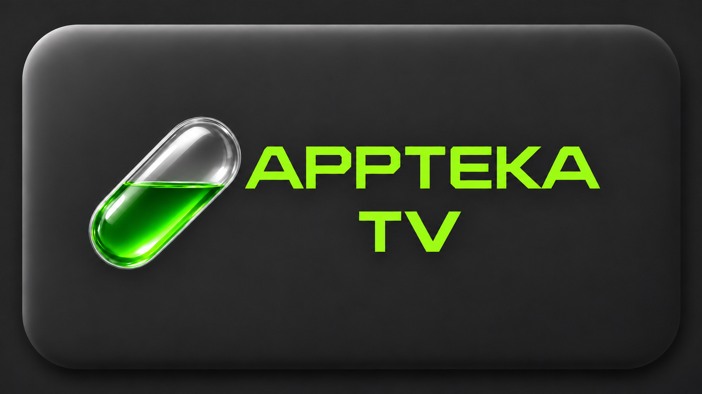

<p align="center">
  
</p>

<p align="center">
  <strong>Appteka for Android TV — driven from the Appteka on your phone</strong>
</p>

<p align="center">
  
  <a href="LICENSE.txt"></a>
  
  
</p>

---

> **🚧 Development in progress — currently being finalized.**
> Active work happens on the [`tv-html`](https://github.com/MOD-PROD/ApptekaTv/tree/tv-html) branch. This `master` branch does not contain the TV version yet; it will be updated once the project is released.

**Appteka TV** is a modified version of [Appteka](https://github.com/solkin/appteka-android), the free and open-source Android app store, built by **ModProd**. It brings Appteka to the big screen and links it to your phone.

One APK, two behaviours:

- **On the TV** — a lightweight interface designed for the remote control (D-pad), usable on its own: installed apps, category rows, search, downloads, app details, settings.
- **On the phone** — the original Appteka (native screens, no web view), with a target switcher **📱 Phone / 📺 TV**. In TV mode, the phone acts *as if it were the TV*: the catalog shows what suits the TV, **Install** installs the app **on the TV**, **My apps** lists the apps **installed on the TV** (launch, update, uninstall), and your Appteka account is shared with the TV.

The catalog, downloads and installation remain Appteka's own.

> This is not the official Appteka repository. For the original app, see [solkin/appteka-android](https://github.com/solkin/appteka-android).

## How it works

1. Install Appteka TV on both your TV and your phone, on the same Wi-Fi network.
2. On the phone, tap the **📱 / 📺 icon** next to the *Store* title.
3. The first time, pair the phone with the TV: **scan the QR code** shown on the TV, or **type the code** displayed on the TV.
4. From then on, the icon switches between the phone and the TV. In TV mode, every action you take in Appteka is carried out on the TV.

The connection between phone and TV is encrypted, each phone gets its own token, and paired phones can be revoked from the TV.

## Roadmap

| Step | Content | Status |
|---|---|---|
| — | TV interface: remote-control navigation, category rows, app details, install/uninstall, search, favorites, account, 9 languages, themes | ✅ done |
| ATV-01 | Pairing by QR code or on-screen code, encrypted link | 🔄 in review |
| ATV-02 | Phone: original home screen, 📱/📺 target switcher, pairing screen | ⏳ to do |
| ATV-03 | "Install on TV" from the original screens | ⏳ to do |
| ATV-04 | The TV's apps on the phone: list, launch, update, uninstall | ⏳ to do |
| ATV-05 | TV-friendly catalog in TV mode (TV categories, TV processor) | ⏳ to do |
| ATV-06 | Shared account phone → TV | ⏳ to do |
| ATV-07 | Streamlined TV interface | ⏳ to do |
| ATV-08 | Documentation and first release | ⏳ to do |

Detailed progress (in French) is in the [`tv-html` README](https://github.com/MOD-PROD/ApptekaTv/blob/tv-html/README.md).

## Differences from Appteka

| | Appteka | Appteka TV |
|---|---|---|
| Android TV launcher | — | Yes (`LEANBACK_LAUNCHER`, TV banner) |
| TV home | — | Remote-control interface |
| Phone home | Native Material UI | The same, plus a 📱/📺 target switcher |
| Phone → TV | — | Install, launch and uninstall apps on the TV over Wi-Fi |
| Default content on TV | Whole catalog | **TV** and **Entertainment** categories (customizable) |
| Package name | `com.tomclaw.appsend` | `app.modprod.apptekatv` (installs alongside the original) |

## Building

Builds run on GitHub Actions: the **Build TV APK** workflow runs on every push to `tv-html` and produces a debug APK and a signed release APK (*Actions → run → Artifacts*).

Local build (JDK 17, Android SDK with API 37):

```bash
git clone -b tv-html https://github.com/MOD-PROD/ApptekaTv.git
cd ApptekaTv
./gradlew assembleDebug
```

## Security

Like Appteka, the catalog is community-driven. Uploaded apps are scanned by Appteka's antivirus, but always check the source, reviews and ratings before installing. Appteka terms: [appteka.store/legal](https://appteka.store/legal).

## License and credits

Appteka TV is derived from **Appteka** © 2016-2026 the Appteka team, released under the **GNU GPL v3**. This repository is distributed under the same license; ModProd's changes (TV interface, TV launcher, phone ↔ TV link) are visible in the Git history.

See [LICENSE.txt](LICENSE.txt) for the full license text.
