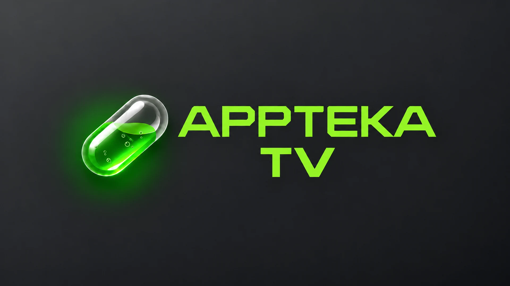

<p align="center">
  
</p>

<p align="center">
  <strong>Appteka sur Android TV, pilotée depuis l'Appteka de votre téléphone</strong>
</p>

<p align="center">
  <a href="LICENSE.txt"></a>
  
  
  
</p>

---

**Appteka TV** est une version modifiée d'[Appteka](https://github.com/solkin/appteka-android), le magasin d'applications Android libre. Un seul APK s'installe sur le téléphone, la tablette et la TV :

- **Sur le téléphone ou la tablette**, c'est l'Appteka d'origine, avec ses écrans natifs (aucune interface HTML). Une icône d'appareil en haut à gauche permet de choisir l'appareil piloté. En mode 📺, le téléphone agit sur la TV : installer, lancer, désinstaller, parcourir ses fichiers, connecter son compte.
- **Sur la TV**, une interface simple à la télécommande, utilisable seule : catalogue, recherche, applis installées, téléchargements, réglages et QR code d'association.

> Ce dépôt n'est pas le dépôt officiel d'Appteka. Pour l'application d'origine, voir [solkin/appteka-android](https://github.com/solkin/appteka-android).

🚧 **En développement.** Les fonctions ci-dessous compilent (CI verte), mais toutes n'ont pas encore été vérifiées sur une vraie TV et un vrai téléphone.

## Fonctions

| Fonction | Où |
|---|---|
| Association téléphone ↔ TV par QR code ou code affiché, confirmée sur la TV, liaison chiffrée (TLS) | téléphone, tablette, TV |
| Plusieurs appareils associés, choisis par un appui long sur l'icône d'appareil | téléphone, tablette |
| « Installer sur la TV » depuis les écrans natifs d'Appteka | téléphone, tablette |
| Applis installées de la TV : liste, lancement, mise à jour, désinstallation | téléphone, TV |
| Gestionnaire de fichiers à distance (téléphone ↔ TV) | téléphone, tablette |
| Connexion de la TV au compte Appteka depuis le téléphone | téléphone, TV |
| Mises à jour intégrées, canaux Stable, Bêta et Test | tous |
| Thèmes, couleur d'accent, logo Appteka TV Store | TV |
| Interface en 13 langues (traductions des ajouts ATV pas encore relues par des natifs) | tous |

Le téléphone trouve la TV sur le réseau local par DNS-SD (`_apptekatv._tcp`, port 8336 par défaut). Code de la liaison : `app/src/main/java/com/tomclaw/appsend/tvlink/` et `.../target/`.

## Installer

1. Télécharger le dernier APK dans les [Releases](https://github.com/MOD-PROD/ApptekaTv/releases) (stable) ou la [version Test](https://github.com/MOD-PROD/ApptekaTv/releases/tag/test-latest).
2. L'installer sur le téléphone et sur la TV (clé USB, gestionnaire de fichiers, `adb install`, ou depuis le téléphone une fois associé).
3. Sur la TV, l'appli apparaît sous le nom **Appteka TV** ; sur le téléphone, sous le nom **Appteka**.
4. Sur le téléphone, appuyer sur l'icône d'appareil puis scanner le QR code affiché par la TV.

L'identifiant `app.modprod.apptekatv` permet de l'installer à côté de l'Appteka d'origine.

## Organisation du dépôt

- **`main`** : la version de référence. Toute publication stable part de `main`.
- **`atv/<sujet>`** : une branche courte par sujet, partie de `main`, avec une pull request. Elle est supprimée une fois fusionnée.
- Les anciennes branches de prototype sont conservées en étiquettes `archive/...`.

| Emplacement | Rôle |
|---|---|
| `app/src/main/assets/tv/` | Interface de la TV (HTML, télécommande) |
| `app/src/main/java/com/tomclaw/appsend/screen/tv/` | Activité TV et pont vers le code natif |
| `app/src/main/java/com/tomclaw/appsend/tvlink/` | Liaison réseau chiffrée téléphone ↔ TV |
| `app/src/main/java/com/tomclaw/appsend/target/` | Appareil piloté, installation et fichiers à distance |
| `design/archive/` | Anciennes images (jamais écrasées, archivées) |

## Compilation

Le workflow **Build TV APK** (`.github/workflows/build-tv-apk.yml`) se lance à chaque push sur `main` et sur les branches `atv/...`. Il produit un APK de débogage et un APK de production signé avec la clé ModProd (secrets du dépôt). Un push sur `main` publie la version Test ; Bêta et Stable se publient à la main (*Run workflow*), Stable uniquement depuis `main`.

En local (JDK 17, SDK Android plateforme 37) :

```bash
git clone https://github.com/MOD-PROD/ApptekaTv.git
cd ApptekaTv
./gradlew assembleStandardDebug
```

Ne jamais ajouter de fichier de clés au dépôt : `*.keystore` et `*.jks` sont ignorés par `.gitignore`.

## Sécurité

Comme Appteka, le catalogue est alimenté par les utilisateurs. Les applis publiées sont analysées par l'antivirus d'Appteka, mais vérifiez la source, les avis et les notes avant d'installer. Conditions d'Appteka : [appteka.store/legal](https://appteka.store/legal).

## Licence et origine

Appteka TV est dérivé d'**Appteka** © 2016-2026 l'équipe Appteka, publié sous licence **GNU GPL v3**. Ce dépôt est distribué sous la même licence ; les modifications sont signalées dans l'historique Git.

Voir [LICENSE.txt](LICENSE.txt) pour le texte complet.
